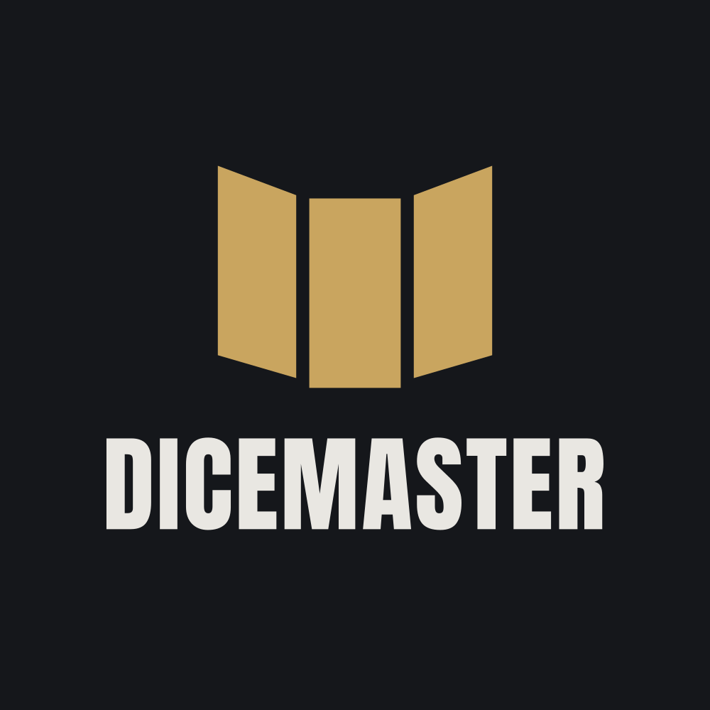

  

<h1 align="center">The dungeon master you could never find</h1>

  A tabletop roleplaying game that runs itself. 
  <b>The rules are code. The storyteller is not.</b>

[DiceMaster.io](https://dicemaster.io) is a browser game built on the System Reference Document 5.1, with an AI Dungeon Master running the table. It's for players who have no group, and for groups who have no DM.

The DM tells the story but never decides what happens. A rules engine implements the SRD and settles every roll, attack and spell; the DM narrates the result after the dice have spoken.

### How a turn works

You act by holding push-to-talk and speaking, by typing, or by clicking the map. Any of the three works at any time. A clear action, like moving or attacking a goblin, goes straight to the engine. A vague one ("I try to talk the guard down") goes to a separate judge model first, which sets a DC, asks what you meant, or tells you it can't be done. Then the engine rolls.

Every roll animates on screen and lands in the log with its modifiers and total, so you can check the DM's story against the dice.

Some SRD spells can't be coded as written. Those get the nearest playable version, the way Baldur's Gate 3 handles them, instead of being dropped. *Wish* gives you a list of concrete choices, and plane travel moves your party to another world.

### The world

Each campaign starts in one of a set of ready-made worlds. When you create it, the game drafts a chapter outline with a villain waiting near the end, and the outline bends to what your party actually does.

The map is a single view you zoom through, from continent to region down to a five-foot tactical grid where terrain and elevation affect movement. Combat begins when an enemy comes into sight, though you can still try to talk or sneak your way past.

Characters are made the old way: pick a race and class, then roll for ability scores and hit points.

### Alone or together

Solo players get AI companions who fight and make their own choices. Groups of up to six join through an invite link, and each player builds a character whenever they get to it.

Missing a session costs you nothing. If someone leaves for good, the DM takes over their character as a companion, and if your character dies, you roll a new one and rejoin the same campaign.

### Memory

[DiceMaster.io](https://dicemaster.io) doesn't summarize your campaign to save space. Every session is kept word for word, and the parts relevant to the current scene are pulled back in when needed, so details from the first session are still there hundreds of hours later.

You get a journal of the NPCs you've met, places you've been, open quests, decisions made and past sessions. It shows only what your party has actually encountered, so it never spoils anything. When you come back after a break, a recap is waiting, and the DM will read it aloud if you ask.

### Voice and models

The DM speaks its narration and NPC dialogue as the text streams in. Roll logs and rules answers stay silent.

The campaign owner chooses which AI model runs the table from a tested list. Each option shows how many hours of play your credits will buy on it, not a price per token. When credits run low, the DM steers toward a long rest or the end of a fight rather than stopping mid-scene.

### Getting in

[DiceMaster.io](https://dicemaster.io) runs in the browser and was designed for phones first. You can sign in with email, a magic link, Google or Discord, and add a passkey or two-factor authentication. The free plan covers solo play; paid plans add parties and more hours.

[DiceMaster.io](https://dicemaster.io) is in active development.
